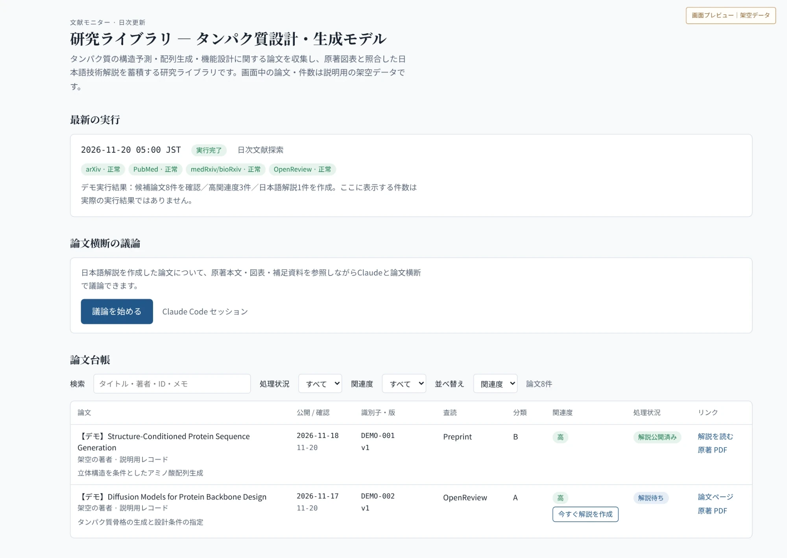
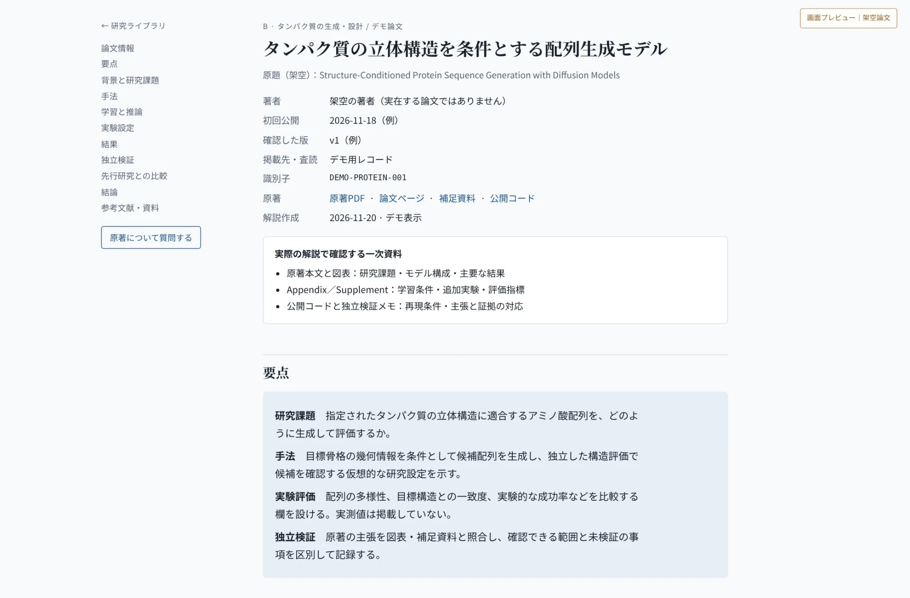
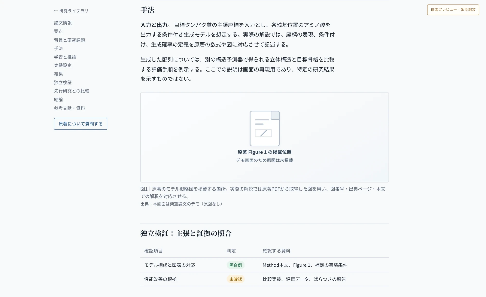
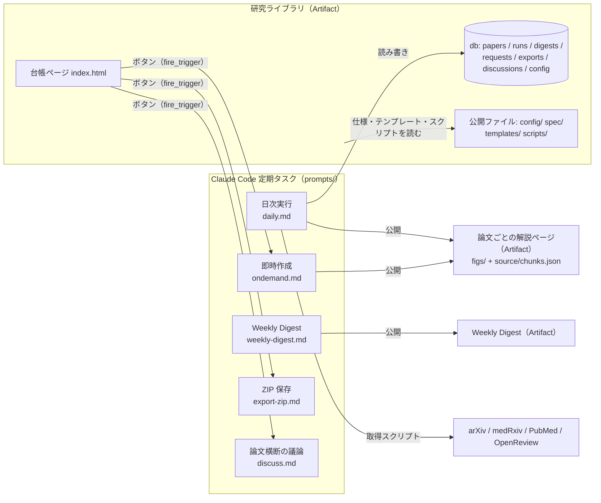

# paper-monitor

研究テーマを決めておくと、**新着論文を毎日探して、原著を読み込んだ図表付きの日本語解説ページを作り、台帳にまとめていく**仕組みです。Claude Code の定期実行（クラウドセッション）と claude.ai の Artifacts の上で動きます。

このリポジトリにあるのはシステム本体（台帳ページ・運用仕様書・解説テンプレート・スクリプト・定期タスクのプロンプト）だけです。解説ページや台帳のデータは含みません。テーマに依存する設定は [`config/topic.json`](config/topic.json) にまとめてあります。

画面中の論文・件数は説明用の架空データです。

## できること

- **毎日の探索**: arXiv・medRxiv/bioRxiv・PubMed・OpenReview を取得漏れなく全件取得し、候補の関連度（high / medium / low / excluded）を判定して台帳に登録する。新着がない日は、ライブラリの論文の土台になっている「キー論文」を選んで解説する。
- **図表付きの日本語解説**: 原著の本文・図表・補足資料・公開コードを直接確認し、独立検証の節（主張ごとに「支持される / 部分的に支持 / 未検証 / 評価範囲を超える」を判定）を含む解説ページを作る。
- **原著に基づくページ内チャット**: 解説ページごとに、原著全文・補足資料・主要な先行研究をチャンク化して載せ、出典（節・ページ）付きで答えるチャットを付ける。
- **台帳ページ**: 全論文を検索・絞り込み・並べ替えできる。解説がない論文はボタンで「今すぐ解説を作成」を依頼できる。
- **コメントでの修正依頼**: 解説ページの該当箇所にコメントして Claude に送ると、次の定期実行で原著と照合して反映し、スレッドに返信する。送らずに残したコメントは「利用者メモ」として扱う。
- **論文横断の議論**: ボタン1つで、全解説の資料を読み込んだ Claude Code セッションを起動し、論文をまたいで議論できる（全論文を1本ずつ確認する規則つき）。
- **Weekly Digest と ZIP 書き出し**: 毎週日曜にその週のまとめを作る。全データを ZIP で保存するボタンもある。

### 解説ページの例

<table>
  <tr>
    <td></td>
    <td></td>
  </tr>
  <tr>
    <td align="center">論文情報と要点</td>
    <td align="center">原著の図と独立検証</td>
  </tr>
</table>

## 処理の頻度

| 処理 | 頻度・動作 |
|---|---|
| 新着論文の収集 | 毎日 |
| 詳細解説 | 1回の実行で原則1〜2本 |
| 未処理の論文 | キューに保持し、後続の実行で処理 |
| 新着がない場合 | 関連する既発表のキー論文を解説 |
| Weekly Digest | 毎週日曜 |
| 個別解説の依頼 | 台帳からオンデマンド実行 |
| 既存解説の修正 | コメントによる依頼を日次実行で処理 |

## 仕組み

- 台帳ページ自体が Artifact で、その db（共有データベース）に台帳・実行ログ・依頼の状態を持ちます。
- 定期実行のセッションは、毎回ライブラリの公開ファイル（このリポジトリと同じ構成）を読み込んで、[`spec/operating-spec.md`](spec/operating-spec.md) の手順どおりに動きます。
- 定型作業は Sonnet、関連度の判定・精読・独立検証・執筆は Opus のサブエージェントが担当します（仕様 §0.1）。

## ファイル構成

| パス | 内容 |
|---|---|
| [`index.html`](index.html) | 研究ライブラリ（台帳ページ）。Artifact として公開する |
| [`config/topic.json`](config/topic.json) | テーマ設定（ライブラリ名、分類、対象判定、検索語、各情報源の検索条件）。[設定項目の説明](docs/configuration.md) |
| [`spec/operating-spec.md`](spec/operating-spec.md) | 運用仕様書。定期実行の各セッションが従う手順 |
| [`templates/paper-template.html`](templates/paper-template.html) | 論文解説ページのテンプレート（ページ内チャット・メモボタン付き） |
| [`prompts/`](prompts/) | 5つの定期タスクのプロンプト |
| [`scripts/`](scripts/) | 取得・チャンク化・組み立て・確認・書き出しのスクリプト（下表） |
| [`docs/setup.md`](docs/setup.md) | セットアップ手順 |

### スクリプト

| スクリプト | 役割 |
|---|---|
| `arxiv_list.py` | arXiv の指定カテゴリの過去1週間を全ページ取得し、題名で候補に印を付ける |
| `medrxiv_fetch.py` | medRxiv / bioRxiv の期間内の全件を取得し、テーマの語・手法の語で印を付ける |
| `pubmed_fetch.py` | PubMed（E-utilities）を検索式で検索し、題名・抄録を取得する |
| `openreview_fetch.py` | OpenReview を語群で全会議検索し、作成日で絞る |
| `html_chunks.py` / `pdf_chunks.py` | arXiv HTML / PDF のテキストを節・ページ付きのチャンクにする |
| `make_source.py` | 本文・先行研究・図表メモ・検証メモのチャンクと資料一覧をまとめる |
| `crop.py` | ページ画像から図表を切り出す |
| `build_page.py` | テンプレートに本文・例題・設定を差し込んで解説ページを組み立てる |
| `qa_search.cjs` / `shot.cjs` | ページ内検索の確認 / Playwright での表示確認 |
| `build_corpus.py` / `corpus_search.py` | 論文横断の議論用コーパスの作成 / BM25 での横断検索と全件確認 |
| `export_zip.py` | 全データの ZIP を作る |

取得スクリプトはどれも、最後に完了状況を1行の JSON で出し、取得漏れがあれば終了コード 2 を返します。検索条件は `config/topic.json` から読みます（`--config <path>` か環境変数 `TOPIC_CONFIG` で別の設定を指定できます）。

## 使い始める

[`docs/setup.md`](docs/setup.md) を見てください。おおまかには、Claude と相談してテーマ設定（`config/topic.json`）を決める → ライブラリを Artifact として公開する → 5つの定期タスクを作る、の3段階です。Claude Code のクラウドセッションでこのリポジトリを開き、「docs/setup.md に従ってセットアップして」と頼めば、Claude が質問しながら進めます。

## 必要なもの

- claude.ai のアカウント（Artifacts の db・sample・comments・mcp の各 capability が使えること）
- Claude Code のクラウドセッションと定期タスク（scheduled tasks）
- 台帳ページのボタンを使う場合: claude.ai の Claude Code Remote コネクタ
- 実行環境のネットワークで arXiv・NCBI・bioRxiv・OpenReview に到達できること

## 注意

- 解説ページには原著の図表の切り出しと全文チャンクが載ります。ページの共有範囲を広げる前に、各論文のライセンスを確認してください。
- 解説は Claude が作成します。独立検証の節や出典の付いたチャットで確かめられるようにしてありますが、重要な判断は原著で確認してください。

## ライセンス

[MIT License](LICENSE)
